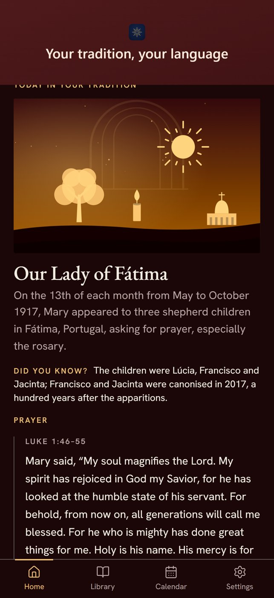
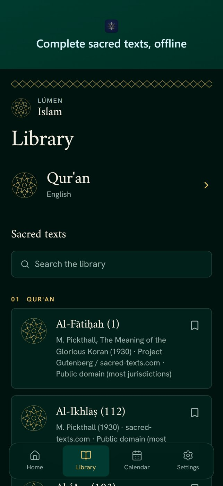
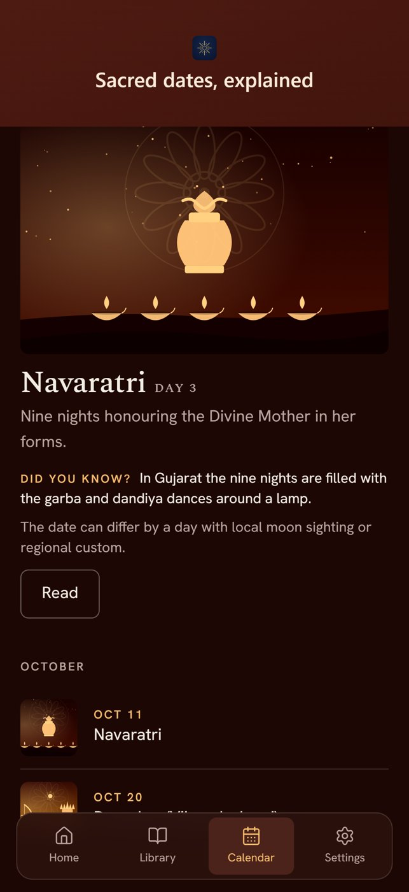

# LÚMEN

Sacred texts and the religious calendar, in your own language. Choose a tradition and read its texts, prayers and dates offline.

**[mylumen.life](https://mylumen.life)** · Web, iOS and Android

## What it does

- Complete sacred texts, readable offline
- A calendar of feasts and holy days with short explanations
- 20 languages

## Built with

TypeScript, React, TanStack Start, Supabase, Capacitor.

The source code is private. This repository only holds the presentation.

---
A product of [Depozza SAS](https://depozza.com).
